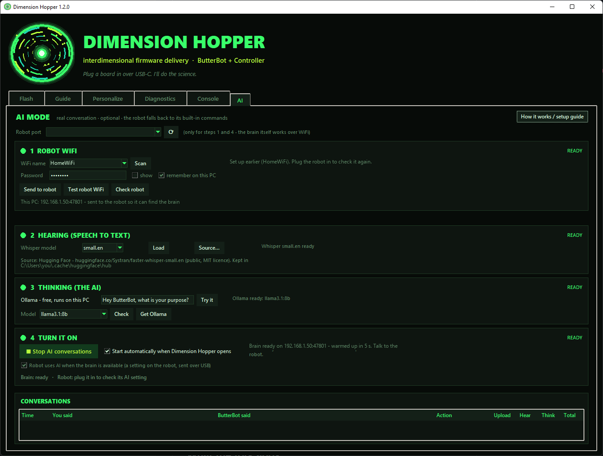

# ButterBot Firmware (community fork)

> A community fork of [CircuitMess/ButterBot-Firmware-Public](https://github.com/CircuitMess/ButterBot-Firmware-Public).
> It works with the stock controller, and gets the most out of the matching controller fork.

This fork is one of three pieces that work together:

| Piece | What it is | Where |
|---|---|---|
| **Robot firmware** | ButterBot itself: voice, driving, AI conversations | this repository |
| **Controller firmware** | The handheld remote | [Exadon/ButterBotCtrl-Firmware-Public](https://github.com/Exadon/ButterBotCtrl-Firmware-Public) |
| **Dimension Hopper** | A Windows app that updates both boards, sets them up and runs the AI "brain" | [tools/updater](tools/updater) in this repository |

## See it in action

| Talking to ButterBot (AI mode) | The controller |
|---|---|
| [](https://www.youtube.com/shorts/QA3H6BbMbJw) | [](https://www.youtube.com/shorts/ISTigiyBVUY) |



## Quick start

1. Download `DimensionHopper.exe` from the [releases page](../../releases) (or build it, see [tools/updater](tools/updater)).
2. Plug the robot in by USB, switch it on (hold the power button about 1 second) and press **Scan dimensions**.
3. Pick *Latest GitHub release* → this fork, and press **BEAM IT**. Do the same for the controller.
4. Optional: open the **AI** tab and follow its four steps to talk to ButterBot for real.

## What the fork adds

### Real conversations (optional)
Press listen, ask anything, and ButterBot answers in character - sarcastic, butter-obsessed - and does the matching
action ("can you dance?" → it dances). The thinking happens on your PC in Dimension Hopper, using free software that
runs locally: [Whisper](https://github.com/SYSTRAN/faster-whisper) turns speech into text and
[Ollama](https://ollama.com) runs the AI model. Your voice never leaves your home network.

- The robot records right after its prompt while WiFi connects in the background, trims the silence and sends a
  compact 8 kHz recording; a typical answer arrives about 5 seconds after you stop talking.
- The controller shows what's happening: *Listening*, *Heard you*, *Consulting my brain…*
- If the PC isn't reachable, the robot says what's wrong in plain words (WiFi not found, wrong password, brain not
  running…) and uses its built-in voice commands for the next two minutes. Nothing breaks.
- WiFi is only switched on for a conversation and off again straight after, because it shares memory and the radio
  with Bluetooth.

### Voices
Eight voice presets: **Classic** (the stock voice), Deep, High, Sassy, Deadpan, Robot (ring-modulated), Retro (8-bit)
and Announcer (with echo). Chosen in Dimension Hopper's *Personalize* tab and saved on the robot.

### Voice commands
- Recognises commands more reliably: a longer listening window and better timing around the prompt, ambiguous matches
  rejected instead of guessed, more ways to say "dance".
- 34 extra chat lines, "do you know &lt;character&gt;" questions about the show's characters, and "open a portal".

### Driving
- Proportional steering in RC mode instead of snapping to 8 directions.
- Front-sensor debouncing so a single false reading doesn't stop the robot.
- Drive the robot from the PC (Dimension Hopper's *Diagnostics* tab) - it refuses to drive forward into an obstacle or
  off an edge, and stops by itself if the app or cable goes away.

### Sturdier
- No more crashes when the controller connects (internal memory ran out), when a setting is saved over USB, or on an
  I²C glitch on the motor board link.
- Pairing recovers from a stale bond instead of getting stuck; *Forget pairing* from the PC.
- Settings survive firmware updates.
- 486 KB smaller app, leaving room for the new features.

### USB console (used by Dimension Hopper)
A status line every 5 seconds (battery, charging, controller link, free memory, why it last restarted, boot count), a
live diagnostics stream, and commands for driving, voices, WiFi setup, network scan, AI mode, pairing and memory/speed
diagnostics. The protocol is plain text, so any serial terminal works too.

## Problems and ideas

See [Troubleshooting](tools/updater/README.md#troubleshooting) for what the robot's messages mean. For anything else,
open an [issue](../../issues) - there's a short form that asks for what's needed.

## Installing a release

Every `v*` tag builds a merged image on GitHub Actions and attaches it to the [releases page](../../releases). The
easiest way to install it is Dimension Hopper: choose *Latest GitHub release* and this repository. Updates keep your
pairing and settings unless you untick *Keep pairing & settings*.

## Building

To build the ButterBot firmware, you'll need the ESP-IDF. You can find the getting started
guide [here](https://docs.espressif.com/projects/esp-idf/en/latest/esp32s3/get-started/).
The production firmware is built using IDF version 5.5.3.

All required components are contained in the repository, and managed components (esp-sr,
esp-dl, esp-tflite-micro, face detection and recognition models, etc.) are fetched
automatically by the IDF component manager during the build.

In the root directory of the project:

**To build the firmware** run ```idf.py build```

**To upload the firmware to the device** run ```idf.py -p <PORT> flash```. Replace `<PORT>` with
the port the robot is attached to, for ex. ```COM6``` or ```/dev/ttyACM0```. Or use Dimension Hopper's
*Use this fork's build*, which only rewrites what changed and keeps your settings.

Flashing also uploads the data partitions: the SPIFFS filesystem image built from
[spiffs](spiffs), the object detection model from [models](models), and the speech
recognition and face detection / recognition models provided by the managed components.

## Restoring the stock firmware

To restore the stock firmware, you can download the prebuilt binary on
the [releases page](https://github.com/CircuitMess/ButterBot-Firmware-Public/releases) of
the original repository and flash it with Dimension Hopper (*Local .bin*) or manually with esptool:

```shell
esptool -c esp32s3 -b 921600 -p <PORT> write_flash 0 ButterBot-Firmware.bin
```

Alternatively, you can also do so using [CircuitBlocks](https://code.circuitmess.com/) by
logging in, clicking the "Restore Firmware" button in the top-right corner, and following the
on-screen instructions.
