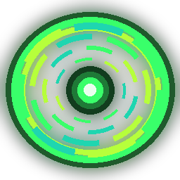
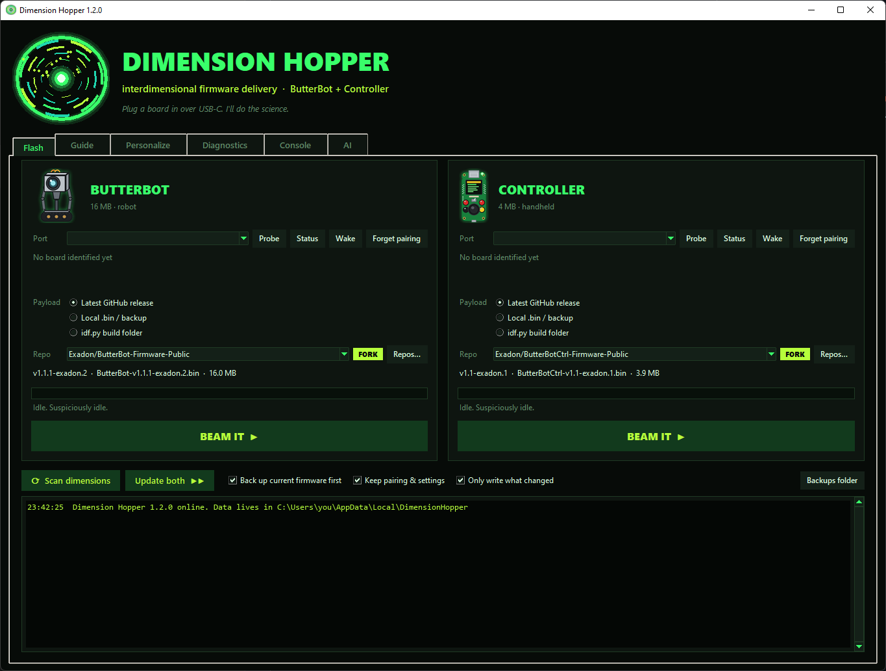
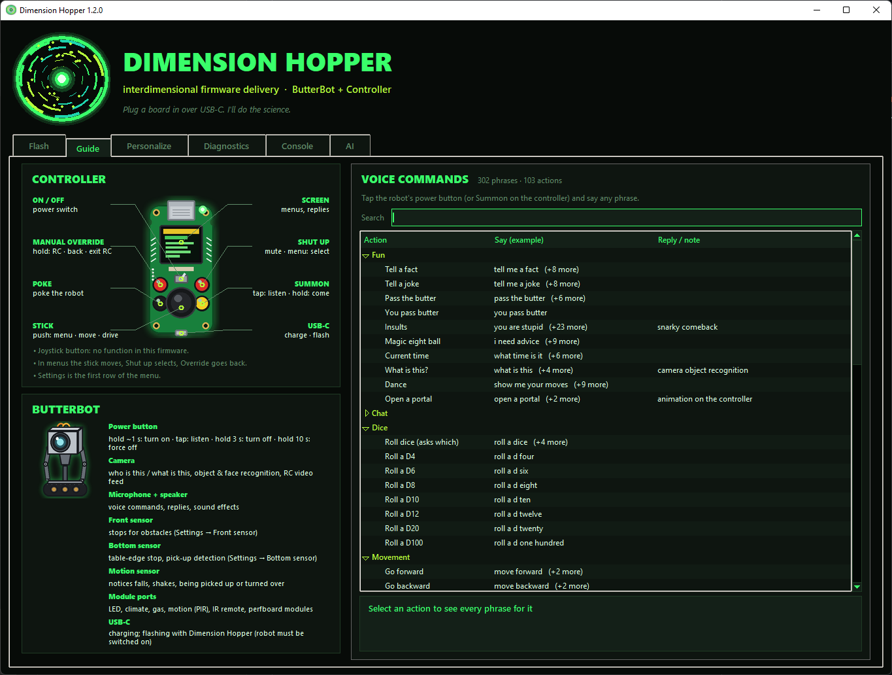
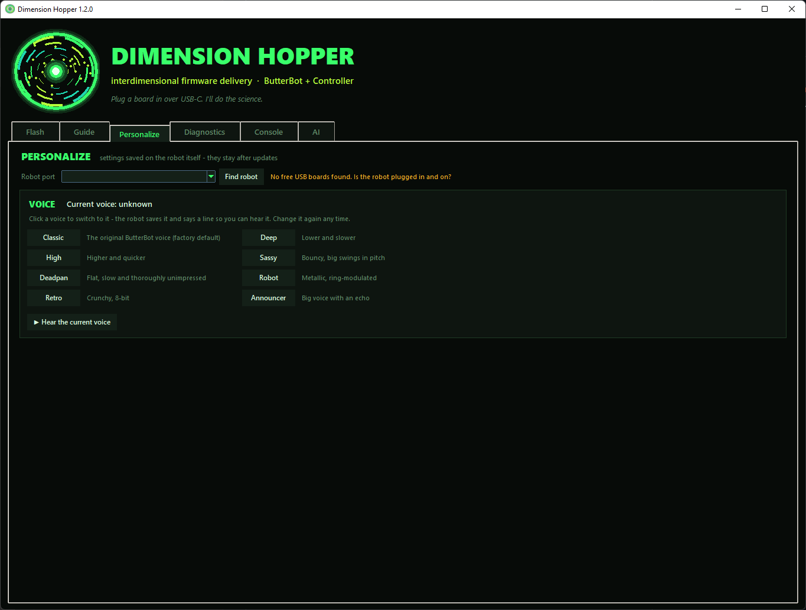
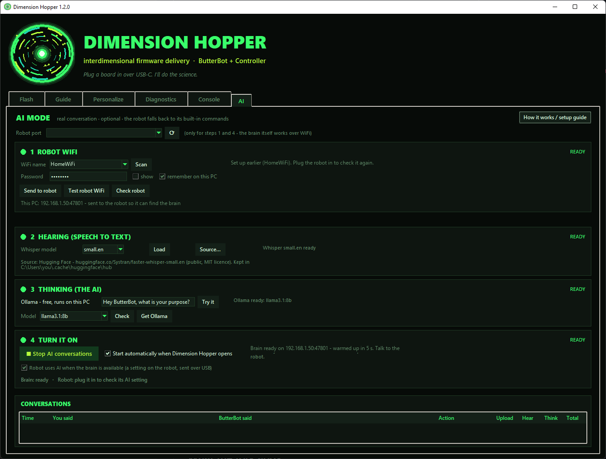

# Dimension Hopper



A one-window app for Windows and Mac for **ButterBot** and its **controller**, with a mad-science look. It updates both boards,
sets them up, lets you test and drive them, and runs the **AI brain** that gives ButterBot real conversations.

Part of the ButterBot community fork - see the [robot firmware](../../README.md) for the overview and the
[controller firmware](https://github.com/Exadon/ButterBotCtrl-Firmware-Public).
Every button has a tooltip: hover over it to see what it does.

### On a Mac

Download `DimensionHopper-mac.zip` from the release (Apple silicon: M1 or newer), unzip it and drag **Dimension
Hopper** into *Applications*. It isn't notarized by Apple, so the first time macOS says it can't check it: open
*System Settings → Privacy & Security*, scroll down and press **Open Anyway** (or run
`xattr -dr com.apple.quarantine /Applications/DimensionHopper.app` once). Everything works as on Windows, with
these differences:

- Ports are called `/dev/cu.usbserial…` instead of `COM7`.
- **Flashing is slower.** macOS's built-in driver for the boards' USB chip (CH340) garbles data above 115200 baud,
  so the app uses 115200 there: a firmware update takes a few minutes, but a full backup of the robot about 25
  (untick *Back up current firmware first* to skip it; your settings are still saved). With WCH's own CH34x driver
  installed the port is called `/dev/cu.wchusbserial…` and the app flashes at full speed.
- Settings, downloads and backups live in `~/Library/Application Support/DimensionHopper` (where this page says
  `%LOCALAPPDATA%\DimensionHopper`), and saved passwords and keys in the macOS Keychain (where it says Windows
  Credential Manager).
- macOS asks once for **Bluetooth** (Controller tab, wireless) and, when you start AI conversations, whether to
  **accept incoming network connections** - allow both.
- It doesn't update itself yet: when the bar says a new version is out, **Update now** opens the release page;
  download the new zip and replace the app (settings stay).

## Tabs

The bar under the title shows which USB port the **ButterBot** and the **Controller** are on; every tab uses it.
**⟳ Scan** there finds them (it listens for their status line first and only probes boards that stay silent), or pick
a port yourself. The big header shows on the Flash tab only; the other tabs get a slim one.

On the right of the bar, the robot at a glance: battery, controller link and how much of its settings storage is free
(*Robot: Battery 87% · Controller linked · Storage 75% free*; hover for the details and the firmware
version). It refreshes every 20 seconds while
nothing else is using the port, and turns amber when the battery is low or the storage is nearly full.

Drag a tab left or right to reorder the tabs; the order is remembered (**About** → *Reset tab order* puts it back).
**About** (top right) shows the version, the author and the project links.

### Updating Dimension Hopper itself

From version 1.4.0 the app keeps itself up to date. At start-up (at most about once a day) it checks this fork's
latest release; when that has a newer Dimension Hopper, a bar at the top offers **Update now**, **What's new** and
**Later**. *Update now* downloads the new `DimensionHopper.exe` next to the running one, checks its SHA-256 against
the release's `dimensionhopper.json` (written by CI), swaps the files and reopens - settings and keys stay where they
are. **About** → *Check for updates* asks straight away. If anything fails (no internet, a folder it can't write to,
a bad download) the current version keeps working and it offers the release page instead. Copies older than 1.4.0
have to be updated by hand once.

### Flash



- **Scan dimensions** (or **⟳ Scan** in the bar at the top) finds the robot and the controller on USB and tells
  them apart.
- **Clockstar watch** (CircuitMess Clockstar v2): once a scan finds one, it gets a third slot next to the other two.
  It's told apart from the controller (also 4 MB) by its USB: the watch uses the ESP32-S3's own, the controller a
  CH340. Its *Latest GitHub release* is this fork's watch firmware, [Exadon/Clockstar-v2-Firmware](https://github.com/Exadon/Clockstar-v2-Firmware)
  (the ButterBot app and everything the Watch tab sets up), or the stock CircuitMess one (**STOCK** badge). Flashing a
  full image replaces the watch's storage, so put your themes back from the Watch tab afterwards;
  backups, local files and build folders work as for the other boards, and *Keep pairing & settings* keeps its phone
  pairing. Its partition table sits at 0x10000 and its app at 0x20000 (0x8000 and 0x10000 on the robot and
  controller); Dimension Hopper reads each image's layout rather than assuming one.
- **Pick a payload per board:**
  - *Latest GitHub release* from this fork (the default - `Exadon/...` with a green **FORK** badge) or the stock
    CircuitMess firmware (**STOCK** badge), plus any repository you add under **Repos…**. Downloads are cached.
    **Check the badge says FORK before beaming** - if you used an older Dimension Hopper it may remember the stock repo.
  - *Local .bin / backup*: a full-flash image, including a backup this app made.
  - *idf.py build folder*: everything a build produced. **Use this fork's build** picks it in one click.
- **Only write what changed** (on by default): compares the board with the image in 64 KB pieces and skips what's
  already there - a typical firmware update takes about a minute.
- **Keep pairing & settings** (on by default): pairing, voice, WiFi, AI settings, routines and everything from the
  Personalize tab survive the update - also when a new release only adds a partition (like 1.1.1-exadon.6's storage
  for routines).
- **Saves your settings first**: before flashing a board that runs this fork's firmware, its settings (names, lines,
  routines, commands, the controller's theme...) go to `%LOCALAPPDATA%\DimensionHopper\auto-backups` (the last 10 per
  board). If the board comes back without them, Dimension Hopper offers to put them back.
- **Refuses foot-guns**: partial images, a robot image on the controller (or the other way round), images bigger than
  the chip.
- **Backs up first** (optional) to `%LOCALAPPDATA%\DimensionHopper\backups`, **verifies** every region after writing,
  then **waits for the board to boot** and checks it's running the version it was given.
- **Update both** flashes the robot and the controller at the same time (each in its own process); if one fails, the
  other still finishes.
- Per board: **Status** (battery, charging, link, firmware, free memory, why it last restarted), **Probe**, **Wake**,
  **Forget pairing**.

The robot only stays on while its power button was held at start-up, so after a flash switch it on again (hold power
about 1 second).

### Guide



Every voice command and the controller's buttons, with pictures.

### Personalize



Make the robot yours:
- **Voice** - nine presets; click one to switch and hear a sample. Classic is the stock voice; **Show accurate** is
  the closest to the show's ButterBot (measured from the episode) and locks the sliders. Pitch and speed sliders
  nudge any other preset (±40 %).
- **Names** - yours (it greets you by name when it recognises your face) and the robot's; both are used by the AI too.
- **Start-up line** - what the robot says when it switches on; `{name}` becomes your name.
- **Summon** - your own lines for when you hold Summon (it starts searching, finds you, can't find you, is charging)
  and for a tap (what it says before it listens for a voice command; keep those under 35 characters). Separate a few
  with `|` and it picks one each time. The same card switches the beeps: a chirp when it has heard an AI question and a
  soft blip while it thinks.
- **Controller** - the theme (Main, Rose, Red, Blue, or the fork's Portal, Butter, Ice, Mono and Purple; it switches
  straight away), screen brightness, sleep time and the **home screen**: the button hints, or a little animated
  ButterBot (bobs, blinks, looks around, rolls to and fro, waves) for people who know the buttons. The home screen can
  also be switched on the controller itself: Settings > HOME. Needs the controller plugged in by USB and this release's
  controller firmware.
- **Your ramble lines** - up to 30 of your own lines, mixed into what the robot mutters when idle.
- **Chat replies** - your own answer to any of the 48 chat voice lines; the controller shows it as a subtitle.
- **AI personality and facts about you** - classic, extra sarcastic, overly dramatic, wholesome, grumpy, or your own
  description, plus a few facts the AI brings up now and then (birthday, pets…). Kept on the PC.
- **Remember past conversations** - after each AI conversation the brain keeps a few short dated notes ("has a maths
  test on Friday") and follows one up now and then. **Memories…** shows them to read, edit or forget. Kept on the PC.
- **Back up… / Restore…** (top right) - everything you've set up on the robot, the controller and this PC (voice,
  names, lines, routines, commands, schedules, theme, AI personality and memories) in one `.json` file, and back.

Cards that need a board stay greyed out until that board answers (one notice at the top says which). Everything on the
robot and controller is saved there, so it survives updates.

### Routines


Your own routines, voice commands and schedules - saved on the robot, so they work without the PC.
- **My routines** - up to 12, each up to 30 steps: *Say a line*, *Built-in action* (tell the time, a joke or a fact,
  pass the butter, open a portal), *Drive* (a direction, speed and time), *Wait*, *Dance*, *LED
  module*. **Save to robot**, then **▶ Run on robot** to try it. Pressing the robot's button stops it.
- **Voice commands** - "when I say *party time*, run *Party*". The robot listens for the phrase offline like its own
  commands (the tab shows the sounds it listens for), and the AI brain runs it too. For names and unusual words,
  **🎤 Teach by voice**: the robot listens three times while you say the phrase and learns how you say it.
- **Schedule** - days and a time for a routine; the robot has to be switched on.
- **Quiet hours** - no idle muttering, wandering or looking around in that window (it can cross midnight).
- **Robot clock** - the robot's time next to the PC's. Dimension Hopper keeps it in sync whenever it finds the robot
  (untick to stop); **Set to** any date and time for testing schedules, **Use PC time** to go back.

### Diagnostics
The robot and the controller side by side, each with its own Connect button (both can be connected at once; the
ports come from the bar at the top):

- **ButterBot:** live sensors, motors, battery, link and motion events; a **joystick** to drive it (drag it, or use
  the arrow keys / WASD; the further you push, the faster it goes - it won't drive forward into an obstacle or off an
  edge, and stops when you let go); and the **camera** -
  what the robot sees, about 1-2 frames a second over USB while it's idle, with **Save snapshot…**.
- **Controller:** the stick position (raw and processed), every button, the robot link and battery; and a live
  **screen mirror** - exactly what the controller's screen shows (only changes travel over USB, so menus keep up),
  with **Save screenshot…** (a sharp PNG at 4x size).

### Controller
A stand-in for the hardware controller, drawn like it: the same four buttons in the same places (click them, or Q/E/Z/C),
a stick you drag (or WASD / arrows) that drives the robot, a screen drawn like the real controller's (its pixel font, windows and texts, with our
own icons and animations) showing what the robot sends, the controller's whole action menu, and a **Robot status** button.

- **USB:** the robot plugged into this PC. Works next to the hardware controller.
- **Bluetooth:** wireless, like the real controller (greyed out, with the reason, if this PC has no Bluetooth).
  **The robot takes one controller at a time**: switch the hardware controller off before connecting here; when you
  disconnect, it reconnects by itself and keeps its pairing.
- **Settings** (activity, front and bottom sensor), like the controller's Settings screen; read from the robot when
  you connect.
- **Camera** (USB only) - what the robot sees while you drive it, about 2 frames a second.
- RC mode with the camera still needs the hardware controller (it makes the WiFi hotspot the camera streams to); here
  the stick drives the robot directly.

### Watch
Shows once a scan has found a Clockstar watch. It needs this fork's watch firmware
([Exadon/Clockstar-v2-Firmware](https://github.com/Exadon/Clockstar-v2-Firmware), the default on the Flash tab); on
the stock watch firmware the tab says so and the rest of Dimension Hopper works as before.

- **Setup:** set the watch's clock to this PC's time (by hand, or whenever a scan finds it), 12 or 24 hours; link it
  to ButterBot (the robot's battery on the watch face, its answers and alarms as notifications); show, hide and
  reorder the watch's menu apps; put a theme on it (four original ones ship with Dimension Hopper) or import one
  made of your own PNGs.
- **Everyday:** steps (today, the last 7 days, the daily goal, how strictly it counts, the activity nudge, save as
  CSV), the watch's four alarms with any mix of weekdays (and **Hear the alarm**), and its battery over the last
  3 days with charging shaded.

### Console
The board's raw log with filters, a table of what the robot heard and matched, a box to send console commands, and
**Save log…**.

### Problem report
**Problem report…** (top right, next to About) saves one text file to attach to a bug report or a forum post: the
versions of Dimension Hopper, Windows/macOS and the boards (the watch too, with its warnings - never its notifications), the USB ports, each board's status, the robot's WiFi state
and its **recent events**, the AI settings and installed Ollama models, the timings and errors of the last AI turns,
and this session's log. It opens the file so you can read it first, then offers to start a GitHub bug report.

The robot keeps its last 80 status lines (WiFi joins and failures with their reason codes, AI turns, memory, storage,
routine runs, system errors) in memory since it switched on - also while unplugged, so plug it in afterwards and the
report has what happened. They're lost when it switches off. Never in the report: WiFi network names and passwords,
IP and MAC addresses, your and the robot's names, API keys, what was said to the AI, memories and facts, and your
Windows/Mac user name.

### AI - real conversations



Four steps, each with a lamp (NOT SET UP / TO DO / WORKING… / READY / PROBLEM). Steps 2-4 unlock once step 1 works.

1. **Robot WiFi** - **Scan** lists the networks the robot can see (2.4 GHz only), pick yours, type the password,
   **Send to robot**, then **Test robot WiFi**. Tick *remember on this PC* to keep the password in Windows Credential
   Manager (the Keychain on a Mac). This PC's address is given to the robot so it finds the brain even when the robot
   and the PC are on different sub-networks (common with mesh WiFi); it stays hidden on screen unless you tick
   *show addresses*.
2. **Hearing** - loads [Whisper](https://github.com/SYSTRAN/faster-whisper) on this PC (base.en, about 140 MB,
   downloaded once from Hugging Face - **Source…** can point it at a mirror or a folder instead).
3. **Thinking** - [Ollama](https://ollama.com), free and local. Install it, run `ollama pull llama3.1:8b` (or
   `llama3.2` on PCs without a strong graphics card), press **Check**, and **Try it** with a typed message. To let the
   robot see ("what do you see?"), also run `ollama pull gemma3:4b` - **Check** then says *Sees with: gemma3:4b*.
4. **Turn it on** - **Start AI conversations** starts the brain and, if the robot is plugged in, sets it up to use it.
   The brain warms up (it runs Whisper once and has the model read ButterBot's instructions) before showing READY, so
   the first answer is as quick as the rest. After the first successful conversation it starts by itself whenever
   Dimension Hopper opens.

The brain also runs your own voice commands (Routines tab) whenever you say their phrase, and hands "what time is
it?" to the robot's own clock instead of letting the AI guess.

**Conversation mode** - hold **Poke + Summon** on the controller for a moment (a *Conversation* bar fills). After
every reply the robot plays a short sound and listens again, no button needed. The brain keeps up to 20 exchanges of
the chat as context (one-off questions get the last 4). It ends with any button on the robot or the controller,
"goodbye" / "that's all" / "stop talking", two turns in a row with nothing heard, or after 25 turns. From the second
turn on, the robot joins WiFi after you've finished speaking rather than while you talk (the robot's internal memory
can't hold both for long), so follow-up answers take a second or two longer. Needs this release on both the robot and
the controller (**Update both** on the Flash tab).

**Seeing** - questions about sight ("what do you see?", "what am I holding?", "what colour is my shirt?", "what is
that?") make the robot take one photo with its camera before the AI answers. With Ollama, a vision model (your chat
model if it can see, otherwise an installed one such as `gemma3:4b`) first writes a plain description of the photo and
your chat model answers in character from it - small models asked to be a butter robot directly "see" butter
everywhere. With Claude, the model sees the photo itself and can also decide to look on its own. The photo is used for
that one answer only: it isn't saved or kept in the chat history. The table marks those answers *[looked]* and shows
the last photo beside it. While the brain runs it keeps both Ollama models loaded, because loading the vision model
from scratch takes longer than the robot waits for an answer. Photos are 128x128 for now (the robot's internal memory
is short while WiFi is on).

The **Conversations** table shows what you said, ButterBot's answer, the action, and how long the upload, hearing and
thinking took. Every conversation is also logged to `%LOCALAPPDATA%\DimensionHopper\brain_log.jsonl`
(on a Mac: `~/Library/Application Support/DimensionHopper/brain_log.jsonl`).

Privacy: your voice goes from the robot to this PC over your own network and is turned into text here; with Ollama the
AI runs here too. Nothing is sent to the internet. The WiFi password goes to the robot over USB and, if you choose,
into Windows Credential Manager or the macOS Keychain - never into a plain file.

## Troubleshooting

**What the robot says when AI mode can't be used**

| The robot says | What it means | What to do |
|---|---|---|
| "My brain is offline, so I'm using my backup circuits." | It couldn't reach Dimension Hopper on the PC. Usually the app is closed, stopped, or the PC is asleep. | Open Dimension Hopper and Start AI conversations. It won't try again for 10 minutes, so the next presses use the built-in commands. If the app *is* running, plug the robot in and press Start (this PC's address may have changed). |
| "I can't find my WiFi network…" | The saved network isn't in range, or isn't 2.4 GHz. | Plug the robot in: AI tab → step 1 → **Scan**, pick the network, **Send to robot**. |
| "My WiFi password doesn't work any more…" | The router rejected the password. | Step 1 → type the new password → **Send to robot** → **Test robot WiFi**. |
| "I can't reach the WiFi right now…" | A hiccup while joining. | Ask again after 2 minutes. If it keeps happening, step 1 → **Test robot WiFi**. |

With the robot plugged in, **Check robot** (step 1) also shows what went wrong the last time.

**Other things**

- **The robot isn't found / "port in use".** Switch the robot on (hold the button about 1 second) - its USB only works
  while it's on. Only one program can use a port at a time: disconnect the Diagnostics or Console tab, or close other
  serial tools.
- **A flash failed part-way.** Nothing is lost - settings live separately. Press **BEAM IT** again (don't press the
  robot's button while it flashes). If the robot no longer reports itself, pick its port by hand and flash again.
- **Answers take long.** The table's *Upload / Hear / Think* columns show where the time goes. Upload depends on
  the WiFi sharing the radio with Bluetooth (usually 1-5 s); Think is the AI model (2-3 s with a graphics card).
- **The status line says this PC's address changed.** Plug the robot in and press Start. To stop it happening, give
  the PC a reserved / fixed address in your router's app.
- **Something else.** Open an issue on [GitHub](https://github.com/Exadon/ButterBot-Firmware-Public/issues) with the
  firmware versions (Flash tab → Status) and, if you can, a saved log from the Console tab.

## Build the exe

```powershell
powershell -ExecutionPolicy Bypass -File build_exe.ps1
```

This produces `dist\DimensionHopper.exe`: a single file with no console and no Python needed on the target PC (it's
large, about 110 MB, because it includes the speech-to-text engine).

## Build the Mac app

```bash
bash build_mac.sh
```

This produces `dist/DimensionHopper.app` and `dist/DimensionHopper-mac.zip` (about 95 MB) for the Mac's own
processor, ad-hoc signed. CI builds it on Apple silicon and attaches the zip to each release.

`bash check_mac.sh` then checks the built app with no boards plugged in: it runs `--selftest` (fails if anything is
MISSING) and saves a `--screenshot` of the window, both into `dist/check`. CI runs the same check on every pull
request that touches `tools/updater/` (`.github/workflows/hopper-mac-check.yml`) and keeps the report and screenshot
as the `DimensionHopper-mac-check` artifact, so a change can be checked without a Mac.

## Run from source

```powershell
py -3 -m venv .venv; .\.venv\Scripts\pip install -r requirements.txt
.\.venv\Scripts\python dimension_hopper.py
```

On a Mac (Python 3.13 from python.org, which brings Tk):

```bash
python3.13 -m venv .venv.nosync && .venv.nosync/bin/pip install -r requirements.txt
.venv.nosync/bin/python dimension_hopper.py
```

Dev flags: `--selftest <out.txt>` checks the bundled esptool, stubs and AI libraries (handy for the windowed exe).

## Files

| File | Purpose |
|---|---|
| `hopper_core.py` | Ports, probe, status, GitHub releases, image checks, quick flash, backup, console commands. No UI. |
| `dimension_hopper.py` | Tk UI: the animated portal, device slots, job runner, log; hosts the tabs. |
| `guide_tab.py`, `personalize_tab.py`, `routines_tab.py`, `diag_tab.py`, `controller_tab.py`, `console_tab.py`, `ai_tab.py` | The tabs. |
| `controller_link.py` | The emulated controller's link to the robot: the message format, over USB or Bluetooth (bleak). |
| `stick_widget.py` | The joystick used by the Controller and Diagnostics tabs. |
| `screen_render.py` | Draws the Controller tab's screen like the real controller's (its font, windows and texts). |
| `gen_screen_data.py` | Makes `screen_data.json` (font, window titles, texts) from the controller firmware sources; run by hand when they change. |
| `brain.py` | The AI brain: Whisper, Ollama, the robot protocol and server, persona, memory and timings. |
| `backup.py` | Back up / restore everything set up on the robot, the controller and the PC (one JSON file). |
| `phonemes.py` | Turns a voice-command phrase into the sounds the robot's recogniser listens for (CMU dictionary + spelling rules). |
| `gen_phonemes.py` | Makes `phonemes.txt.gz` from the [CMU Pronouncing Dictionary](https://github.com/cmusphinx/cmudict) (licence in `CMUDICT_LICENSE`); run by hand. |
| `self_update.py` | Checks the latest release for a newer Dimension Hopper and swaps the exe in place. |
| `tooltip.py` | Hover help for every button. |
| `mac_compat.py` | Makes the Windows-designed UI look the same on a Mac (fonts, sizes, coloured buttons). |
| `build_exe.ps1` | Reproducible PyInstaller build (Windows). |
| `build_mac.sh` | The same for the Mac app. |
| `check_mac.sh` | Self-test and screenshot of the built Mac app (CI runs it on pull requests). |
| `make_art.py` | Regenerates the art: `portal.ico`/`portal.png` (app icon), `bot.png` and `controller.png` (slot icons). |
