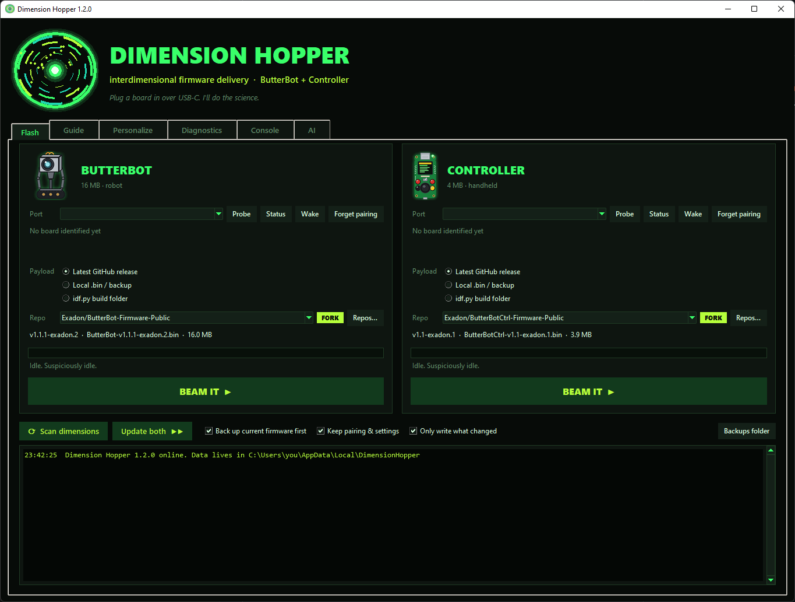
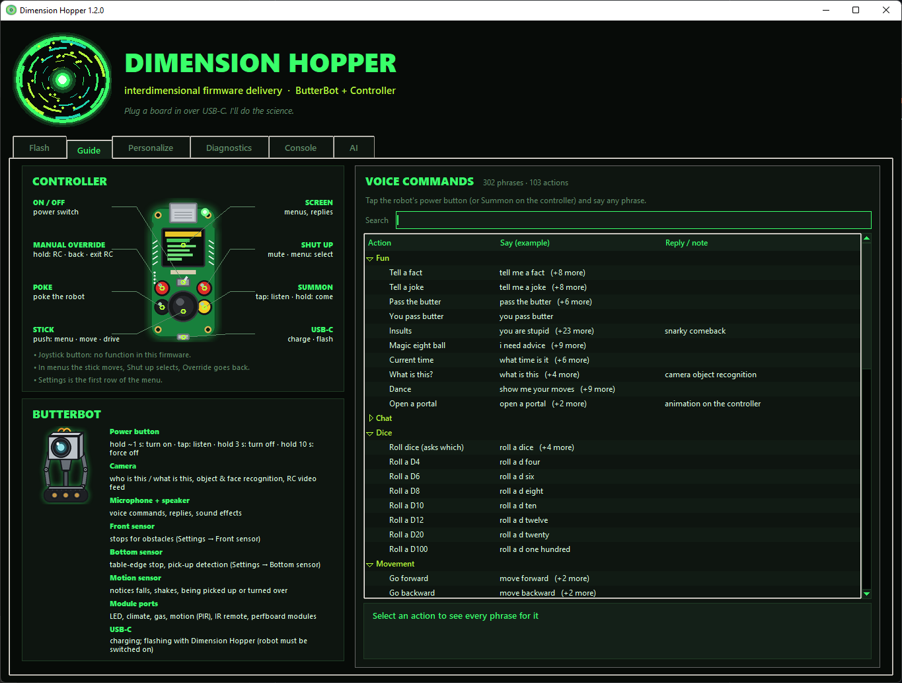
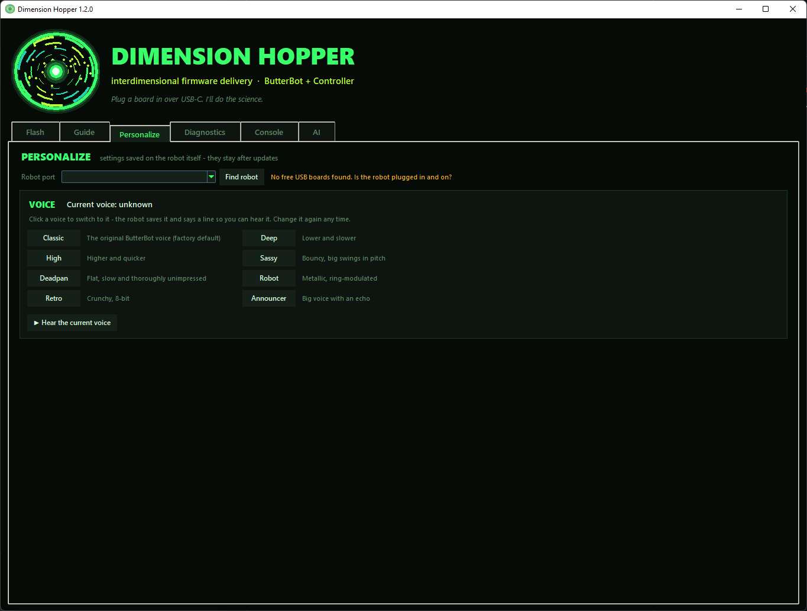
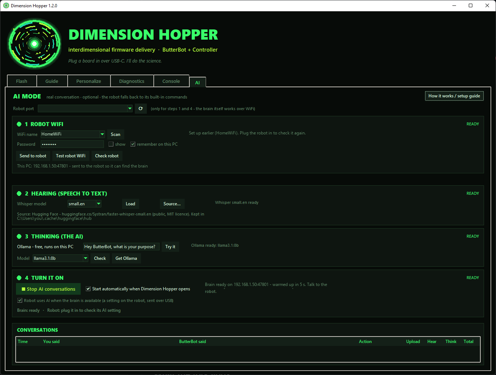

# Dimension Hopper


A one-window Windows app for **ButterBot** and its **controller**, with a mad-science look. It updates both boards,
sets them up, lets you test and drive them, and runs the **AI brain** that gives ButterBot real conversations.

Part of the ButterBot community fork - see the [robot firmware](../../README.md) for the overview and the
[controller firmware](https://github.com/Exadon/ButterBotCtrl-Firmware-Public).
Every button has a tooltip: hover over it to see what it does.

## Tabs

### Flash



- **Scan dimensions** finds the robot and the controller on USB and tells them apart (it listens for their status
  line first, and only probes boards that stay silent).
- **Pick a payload per board:**
  - *Latest GitHub release* from this fork (the default - `Exadon/...` with a green **FORK** badge) or the stock
    CircuitMess firmware (**STOCK** badge), plus any repository you add under **Repos…**. Downloads are cached.
    **Check the badge says FORK before beaming** - if you used an older Dimension Hopper it may remember the stock repo.
  - *Local .bin / backup*: a full-flash image, including a backup this app made.
  - *idf.py build folder*: everything a build produced. **Use this fork's build** picks it in one click.
- **Only write what changed** (on by default): compares the board with the image in 64 KB pieces and skips what's
  already there - a typical firmware update takes about a minute.
- **Keep pairing & settings** (on by default): pairing, voice, WiFi and AI settings survive the update.
- **Refuses foot-guns**: partial images, a robot image on the controller (or the other way round), images bigger than
  the chip.
- **Backs up first** (optional) to `%LOCALAPPDATA%\DimensionHopper\backups`, **verifies** every region after writing,
  then **waits for the board to boot** and checks it's running the version it was given.
- **Update both** does the robot and then the controller.
- Per board: **Status** (battery, charging, link, firmware, free memory, why it last restarted), **Probe**, **Wake**,
  **Forget pairing**.

The robot only stays on while its power button was held at start-up, so after a flash switch it on again (hold power
about 1 second).

### Guide



Every voice command and the controller's buttons, with pictures.

### Personalize



Settings that live on the robot. Right now: its **voice** - click one of the eight presets to switch to it and hear a
sample. Classic is the stock voice.

### Diagnostics
The robot and the controller side by side, each with its own port and Connect button (both can be connected at once;
the ports are filled in from the Flash tab after a scan):

- **ButterBot:** live sensors, motors, battery, link and motion events; a **drive pad** (hold an arrow, or use the arrow
  keys / WASD - it won't drive forward into an obstacle or off an edge, and stops when you let go); and the **camera** -
  what the robot sees, about 1-2 frames a second over USB while it's idle, with **Save snapshot…**.
- **Controller:** the stick position (raw and processed), every button, the robot link and battery; and a live
  **screen mirror** - exactly what the controller's screen shows (only changes travel over USB, so menus keep up),
  with **Save screenshot…** (a sharp PNG at 4x size).

### Console
The board's raw log with filters, a table of what the robot heard and matched, a box to send console commands, and
**Save log…**.

### AI - real conversations



Four steps, each with a lamp (NOT SET UP / TO DO / WORKING… / READY / PROBLEM). Steps 2-4 unlock once step 1 works.

1. **Robot WiFi** - **Scan** lists the networks the robot can see (2.4 GHz only), pick yours, type the password,
   **Send to robot**, then **Test robot WiFi**. Tick *remember on this PC* to keep the password in Windows Credential
   Manager. The line underneath shows this PC's address, which is given to the robot so it finds the brain even when
   the robot and the PC are on different sub-networks (common with mesh WiFi).
2. **Hearing** - loads [Whisper](https://github.com/SYSTRAN/faster-whisper) on this PC (base.en, about 140 MB,
   downloaded once from Hugging Face - **Source…** can point it at a mirror or a folder instead).
3. **Thinking** - [Ollama](https://ollama.com), free and local. Install it, run `ollama pull llama3.1:8b` (or
   `llama3.2` on PCs without a strong graphics card), press **Check**, and **Try it** with a typed message.
4. **Turn it on** - **Start AI conversations** starts the brain and, if the robot is plugged in, sets it up to use it.
   The brain warms up (it runs Whisper once and has the model read ButterBot's instructions) before showing READY, so
   the first answer is as quick as the rest. After the first successful conversation it starts by itself whenever
   Dimension Hopper opens.

The **Conversations** table shows what you said, ButterBot's answer, the action, and how long the upload, hearing and
thinking took. Every conversation is also logged to `%LOCALAPPDATA%\DimensionHopper\brain_log.jsonl`.

Privacy: your voice goes from the robot to this PC over your own network and is turned into text here; with Ollama the
AI runs here too. Nothing is sent to the internet. The WiFi password goes to the robot over USB and, if you choose,
into Windows Credential Manager - never into a plain file.

## Troubleshooting

**What the robot says when AI mode can't be used**

| The robot says | What it means | What to do |
|---|---|---|
| "My brain is offline, so I'm using my backup circuits." | It couldn't reach Dimension Hopper on the PC. Usually the app is closed, stopped, or the PC is asleep. | Open Dimension Hopper and Start AI conversations. It won't try again for 10 minutes, so the next presses use the built-in commands. If the app *is* running, plug the robot in and press Start (this PC's address may have changed). |
| "I can't find my WiFi network…" | The saved network isn't in range, or isn't 2.4 GHz. | Plug the robot in: AI tab → step 1 → **Scan**, pick the network, **Send to robot**. |
| "My WiFi password doesn't work any more…" | The router rejected the password. | Step 1 → type the new password → **Send to robot** → **Test robot WiFi**. |
| "I can't reach the WiFi right now…" | A hiccup while joining. | Ask again after 2 minutes. If it keeps happening, step 1 → **Test robot WiFi**. |

With the robot plugged in, **Check robot** (step 1) also shows what went wrong the last time.

**Other things**

- **The robot isn't found / "port in use".** Switch the robot on (hold the button about 1 second) - its USB only works
  while it's on. Only one program can use a port at a time: disconnect the Diagnostics or Console tab, or close other
  serial tools.
- **A flash failed part-way.** Nothing is lost - settings live separately. Press **BEAM IT** again (don't press the
  robot's button while it flashes). If the robot no longer reports itself, pick its port by hand and flash again.
- **Answers take long.** The table's *Upload / Hear / Think* columns show where the time goes. Upload depends on
  the WiFi sharing the radio with Bluetooth (usually 1-5 s); Think is the AI model (2-3 s with a graphics card).
- **The status line says this PC's address changed.** Plug the robot in and press Start. To stop it happening, give
  the PC a reserved / fixed address in your router's app.
- **Something else.** Open an issue on [GitHub](https://github.com/Exadon/ButterBot-Firmware-Public/issues) with the
  firmware versions (Flash tab → Status) and, if you can, a saved log from the Console tab.

## Build the exe

```powershell
powershell -ExecutionPolicy Bypass -File build_exe.ps1
```

This produces `dist\DimensionHopper.exe`: a single file with no console and no Python needed on the target PC (it's
large, about 110 MB, because it includes the speech-to-text engine).

## Run from source

```powershell
py -3 -m venv .venv; .\.venv\Scripts\pip install -r requirements.txt
.\.venv\Scripts\python dimension_hopper.py
```

Dev flags: `--selftest <out.txt>` checks the bundled esptool, stubs and AI libraries (handy for the windowed exe).

## Files

| File | Purpose |
|---|---|
| `hopper_core.py` | Ports, probe, status, GitHub releases, image checks, quick flash, backup, console commands. No UI. |
| `dimension_hopper.py` | Tk UI: the animated portal, device slots, job runner, log; hosts the tabs. |
| `guide_tab.py`, `personalize_tab.py`, `diag_tab.py`, `console_tab.py`, `ai_tab.py` | The tabs. |
| `brain.py` | The AI brain: Whisper, Ollama, the robot protocol and server, persona and timings. |
| `tooltip.py` | Hover help for every button. |
| `build_exe.ps1` | Reproducible PyInstaller build. |
| `make_art.py` | Regenerates the art: `portal.ico`/`portal.png` (app icon), `bot.png` and `controller.png` (slot icons). |
